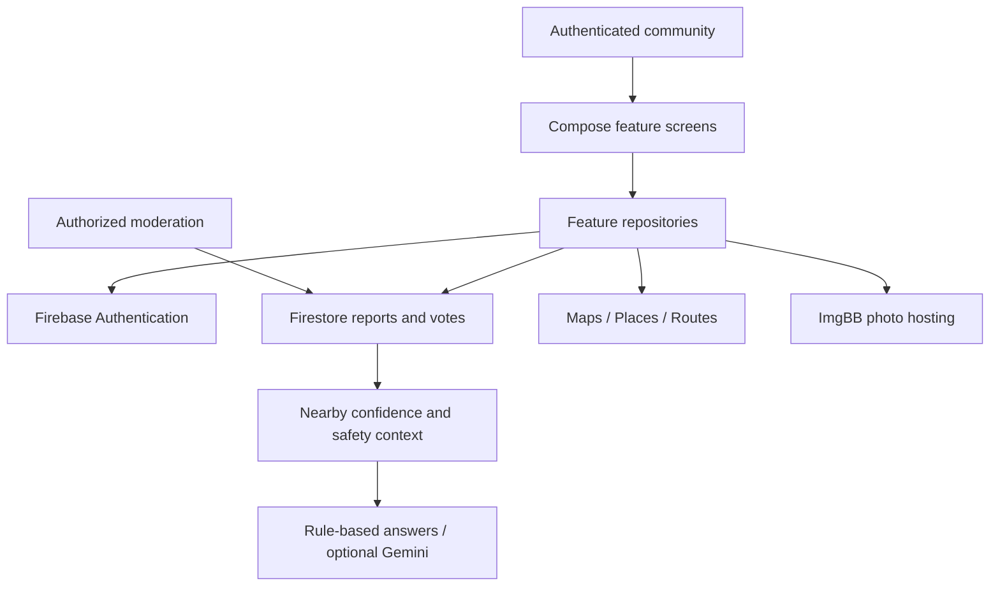

# Safe IQ

**A community safety application that brings hazard reports, verification and nearby context into one Android experience.**

  

## Safety information needs context and evidence

Community reports can be useful before official information reaches everyone, but an unverified report is not a confirmed fact. Safe IQ combines user-submitted hazards, community responses and an administrative verification layer so people can inspect the evidence behind local safety information.

Its safety score is a transparent heuristic based on nearby reports. Optional generative answers add a conversational interface; they do not turn the score into a trained predictive model.

## Four connected experiences

### Report and discuss

Submit categorized hazards with severity, description and location; attach a photo through the image-hosting integration. Report details include comments, community votes and a verification timeline. Reporting and moderation remain distinct responsibilities.

### Explore nearby context

The app includes distance-oriented feeds, alert filtering and Google Maps views. The inspected source adds clustered markers, place search and a Routes API client for driving-route context. Backend permissions, enabled APIs, billing and quotas govern whether those external services operate.

### Ask and listen

The assistant computes explainable nearby safety context, offers rule-based answers and can call Gemini. Speech-recognition and text-to-speech components provide a voice interface. The assistant falls back to rule-based responses when generation is unavailable; cloud generation can still produce incorrect answers.

### Verify and manage

Administrative screens support verification, moderation, analytics and audit records. Users also have profile, preferences and parked-car workflows. Firebase rules represent server-side authorization boundaries; an interface gesture or PIN alone is not a sufficient authorization mechanism.

## System workflow and architecture

The application uses Kotlin, Compose, Hilt and coroutines. Feature ViewModels expose lifecycle-aware state; repositories isolate Firebase and external-service access. Email/password and Google sign-in are implemented. The current module also includes Firebase messaging components and local hazard notifications; a complete server push pipeline was not established by this inspection.

## Engineering decisions and integration boundaries

Image uploads use an ImgBB implementation with orientation correction and JPEG compression. That avoids tying the current upload path to Firebase Storage, while introducing a separate service and API credential boundary.

The AI layer separates deterministic safety calculations from generated language and fallback answers. This keeps the score's inputs explainable even when cloud generation fails.

## Security and development status

The security document records rules hardening, verified administrator identity checks, generic login errors and release minification. It also records outstanding deployment/device actions and residual risks. Source inspection found embedded service credentials and a default admin PIN; their values and owner identities are excluded from this showcase.

Core reporting, moderation and intelligence features are present, with newer map, voice and upload work beyond the older README. Production deployment, rule acceptance, service restrictions and release-device behavior have not been revalidated here. The project lacks wrapper scripts and the wrapper JAR locally, so command-line build instructions in its README are incomplete for a fresh checkout.

## Visual evidence and roadmap

No reviewed standalone screenshots were found in the inspected project assets. A safe demonstration should use fictional hazard reports, synthetic map locations and test accounts, and should show confidence and verified status separately.

- Establish a complete, reproducible Android build setup.
- Verify current Firebase rules and external API restrictions.
- Capture synthetic report, vote, map and assistant workflows.
- Review image-hosting and AI credential delivery before distribution.
- Complete release-device and permission-revocation acceptance.

Portfolio owner: [chiranjit-chakma](https://github.com/chiranjit-chakma). Acknowledgements include Android, Firebase, Google Maps/Places/Routes, Gemini, ImgBB, Compose and Hilt. This repository presents the product and engineering case study; proprietary source is kept private.
